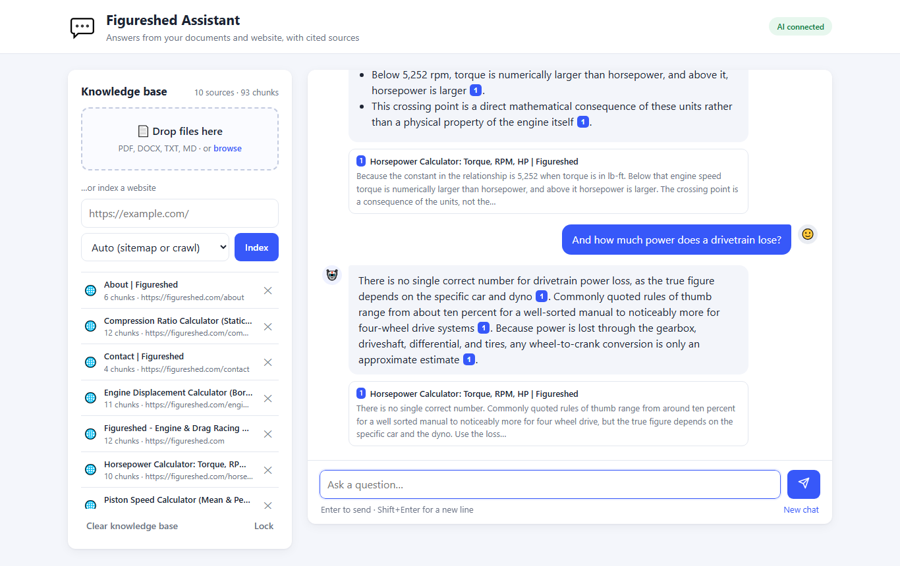
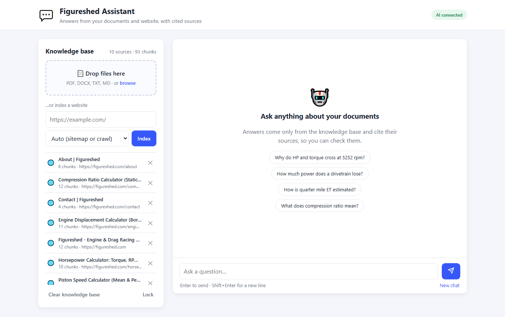
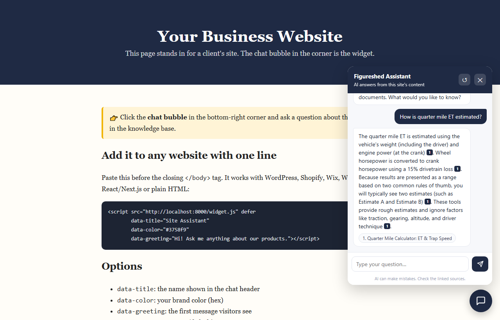
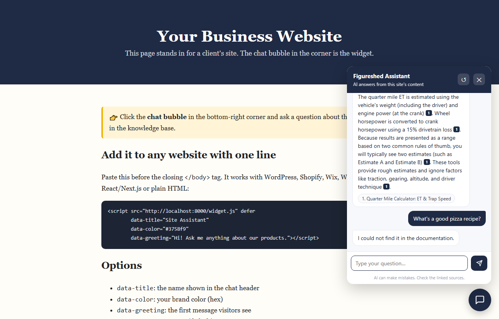

# 💬 AI RAG Chatbot – Chat with your documents & website

A chatbot that answers questions **only from your own content**: PDFs, Word docs, text files or a **whole website** (crawled from its sitemap). Every answer **cites its sources**, and you can drop it onto any website with **one line of code**.

It works with **any OpenAI-compatible LLM**, including **free** ones (Google Gemini, Groq, GitHub Models or a local Ollama model). Embeddings run **locally**, so indexing costs nothing and has no rate limits.

> 🏁 **Real-world demo:** the knowledge base in the screenshots is the live site [figureshed.com](https://figureshed.com), a set of engine and drag-racing calculators. The bot was trained on it with one command: `python -m scripts.ingest_site https://figureshed.com/`

---

## 📸 Screenshots

**1. Ask a question, get a cited answer.** Answers stream in word by word. The numbered badges link to the exact source, and follow-up questions keep their context:



**2. Knowledge base.** Upload files or paste a website URL. The bot finds the sitemap (or crawls the links) and indexes every page:



**3. Embeddable widget.** A chat bubble for any website (WordPress, Shopify, Wix, Webflow, Next.js, plain HTML):



**4. No made-up answers.** If the question isn't covered, the bot says so instead of guessing:



---

## ✨ Features

- **Train it on a website in one step.** It reads `sitemap.xml` (including sitemap indexes) or crawls same-domain links, respects `robots.txt`, and strips menus, footers and scripts so only real content is indexed.
- **Documents:** PDF (cited per page), DOCX (keeps headings and tables), TXT and Markdown.
- **Cited answers.** Each claim is tagged `[1]`, `[2]`… and shown as clickable source cards, and only the sources actually used are listed.
- **Refuses to guess.** When nothing relevant is found, the bot replies "not in the docs" **without calling the LLM**. That saves free quota and blocks made-up answers and prompt injection.
- **Follow-up questions** ("and for 4WD?") work through short conversation memory.
- **Streaming replies** using Server-Sent Events.
- **One-line embeddable widget** with a Shadow DOM, so the host site's CSS can't break it. It's mobile friendly, keeps the chat across page loads, and supports brand color, title and greeting options.
- **Built to run publicly on a free key:** per-IP and daily rate limits, a question length cap, a CORS allow-list and an admin token for anything that changes the knowledge base.
- **Re-indexing replaces old content** instead of duplicating it. Sources can be deleted one at a time.
- **Free to run:** local embeddings (fastembed / ONNX, no GPU), a free-tier LLM and a free host (Hugging Face Spaces).
- **60 automated tests** that run offline with no API key.

## 🛠 Tech stack

Python 3.11+ · FastAPI · ChromaDB (vector database) · fastembed (`BAAI/bge-small-en-v1.5` embeddings) · OpenAI SDK (any compatible provider) · BeautifulSoup + httpx (crawler) · PyMuPDF · python-docx · vanilla JS frontend (no build step) · pytest · Docker

## 📁 Project structure

```
rag-chatbot/
├── app/
│   ├── main.py          # FastAPI routes: chat, streaming, admin, widget
│   ├── rag.py           # retrieve → relevance check → prompt → cited answer
│   ├── vectorstore.py   # ChromaDB + local fastembed embeddings
│   ├── loaders.py       # PDF / DOCX / TXT / web page / sitemap / crawler
│   ├── chunker.py       # heading-aware chunking with overlap
│   ├── llm_client.py    # provider-agnostic LLM client (+ streaming, 429 handling)
│   ├── ratelimit.py     # per-IP + daily limits for the public demo
│   ├── config.py        # all settings from .env
│   └── schemas.py
├── static/
│   ├── index.html, app.js, style.css   # full web app
│   ├── widget.js                       # embeddable chat bubble
│   └── widget-demo.html                # "client website" demo page
├── scripts/ingest_site.py   # index a site or files from the command line
├── tests/                   # 60 tests, offline, no API key needed
├── Dockerfile               # Hugging Face Spaces / Render / any VPS
└── .env.example
```

## 🚀 Setup

```bash
git clone https://github.com/awais1221/ai-rag-chatbot.git
cd ai-rag-chatbot
python -m venv venv
# Windows
venv\Scripts\activate
# macOS / Linux
source venv/bin/activate
pip install -r requirements.txt
```

Create your settings file:

```bash
# Windows (PowerShell)
copy .env.example .env
# macOS / Linux
cp .env.example .env
```

Then edit `.env`:

1. **LLM.** Get a free Gemini key at <https://aistudio.google.com/apikey> and set `API_KEY`. (Groq, GitHub Models and Ollama are listed as alternatives in `.env.example`.)
2. **Admin token.** Set `ADMIN_TOKEN` to a long random string. You need it to upload documents from the web UI:
   `python -c "import secrets; print(secrets.token_urlsafe(24))"`
3. Optional: set `BOT_NAME`, `SUGGESTIONS` (starter questions separated by `|`) and `CONTACT_URL`.

## ▶️ Run

```bash
# 1. Add content: a website, a sitemap, a single page and/or local files
python -m scripts.ingest_site https://figureshed.com/
python -m scripts.ingest_site docs/handbook.pdf docs/faq.md

# 2. Start the server
uvicorn app.main:app --reload
```

- Web app: <http://127.0.0.1:8000>. Unlock the knowledge-base panel with your admin token to upload files or index URLs.
- Widget demo: <http://127.0.0.1:8000/static/widget-demo.html>
- API docs (Swagger): <http://127.0.0.1:8000/docs>

The first start downloads the embedding model (about 130 MB) once.

## 🌐 Add the widget to a website

```html
<script src="https://YOUR-SERVER/widget.js" defer
        data-title="Site Assistant"
        data-color="#3758f9"
        data-greeting="Hi! Ask me anything about our products."></script>
```

Add that website's address to `ALLOWED_ORIGINS` in `.env`, for example `ALLOWED_ORIGINS=https://www.example.com`.

## 🔌 API usage

```bash
# Ask a question (JSON answer + sources)
curl -X POST http://127.0.0.1:8000/chat -H "Content-Type: application/json" \
     -d '{"question": "Why do HP and torque cross at 5252 rpm?"}'

# Streaming (Server-Sent Events)
curl -N -X POST http://127.0.0.1:8000/chat/stream -H "Content-Type: application/json" \
     -d '{"question": "How much power does a drivetrain lose?"}'

# Admin: index a website / upload files / list sources
curl -X POST http://127.0.0.1:8000/ingest/url -H "X-Admin-Token: $TOKEN" \
     -H "Content-Type: application/json" -d '{"url": "https://example.com/"}'
curl -X POST http://127.0.0.1:8000/ingest/files -H "X-Admin-Token: $TOKEN" -F "files=@manual.pdf"
curl http://127.0.0.1:8000/sources -H "X-Admin-Token: $TOKEN"
```

Example response from `/chat`:

```json
{
  "answer": "Horsepower and torque curves cross at 5,252 rpm because of the constant used when torque is measured in lb-ft [1]. ...",
  "sources": [
    {
      "index": 1,
      "title": "Horsepower Calculator: Torque, RPM, HP | Figureshed",
      "url": "https://figureshed.com/horsepower-calculator",
      "snippet": "Because the constant in the relationship is 5,252 when torque is in lb-ft...",
      "score": 0.84
    }
  ],
  "found": true
}
```

## ⚙️ How it works

1. **Load.** Files and web pages become clean text. Web pages lose their menus, footers and scripts, and keep headings and tables.
2. **Chunk.** The text is split at headings, then into pieces of about 800 characters with overlap. Each chunk keeps its heading so it still makes sense on its own.
3. **Embed and store.** A small local model turns every chunk into a vector, and the vectors are stored in ChromaDB.
4. **Retrieve.** A question is embedded the same way, and the closest chunks are found by cosine similarity. For follow-ups, the previous question is searched too.
5. **Relevance gate.** If the best match scores below `MIN_SCORE` (default 0.55), the bot replies "not found" and **the LLM is never called**. Measured on the demo site, on-topic questions score 0.65 to 0.87 and off-topic ones 0.36 to 0.48.
6. **Generate.** The LLM gets numbered sources and strict instructions to answer only from them and cite `[n]`. The answer streams to the browser, and only the sources it actually cited are shown.

## ☁️ Free deployment (Hugging Face Spaces)

1. Create a new Space, choose **Docker**, then push this repo to it. The Space's README needs `sdk: docker` and `app_port: 7860` in its YAML header.
2. Under **Settings → Variables and secrets**, add `API_KEY`, `BASE_URL`, `MODEL_NAME`, `ADMIN_TOKEN`, `ALLOWED_ORIGINS`, `BOT_NAME` and `SUGGESTIONS`. Add `SEED_URLS` (for example `https://figureshed.com/`) so the site is re-indexed automatically after each restart, because free Spaces have no persistent disk.
3. Use `https://<user>-<space>.hf.space/widget.js` in the widget snippet.

Free Spaces go to sleep after a period with no visitors. The first message after that takes 30 to 60 seconds, and the widget shows a "waking up" note while it waits.

## 🧪 Tests

```bash
pytest -v                 # 60 tests
SKIP_SLOW=1 pytest        # skip the one test that loads the real embedding model
```

The tests cover chunking, every loader (with a mocked website: sitemaps, sitemap indexes, crawling, robots.txt), the vector store, the RAG pipeline (relevance gate, citations, history, follow-ups, streaming), the rate limiter and every API endpoint (auth, validation, CORS, error handling). The LLM is mocked, so no API key or internet connection is needed.

## 🚧 Limitations and future improvements

- Free LLM tiers have rate limits. The bot handles `429` errors and shows a friendly message.
- Rate-limit counters live in memory, so they reset on restart and assume a single instance. Use Redis to run several instances.
- Scanned (image-only) PDFs are not OCR'd yet.
- There is one shared knowledge base. Multi-tenant (one per client) is the next step.
- Pages that build their content with JavaScript after loading aren't crawled. Server-rendered and static sites work.
- Ideas: a lead-capture form in the widget, Telegram/WhatsApp channels, an analytics dashboard of common unanswered questions, and hybrid keyword + vector search.

## 📄 License

MIT. See [LICENSE](LICENSE).
